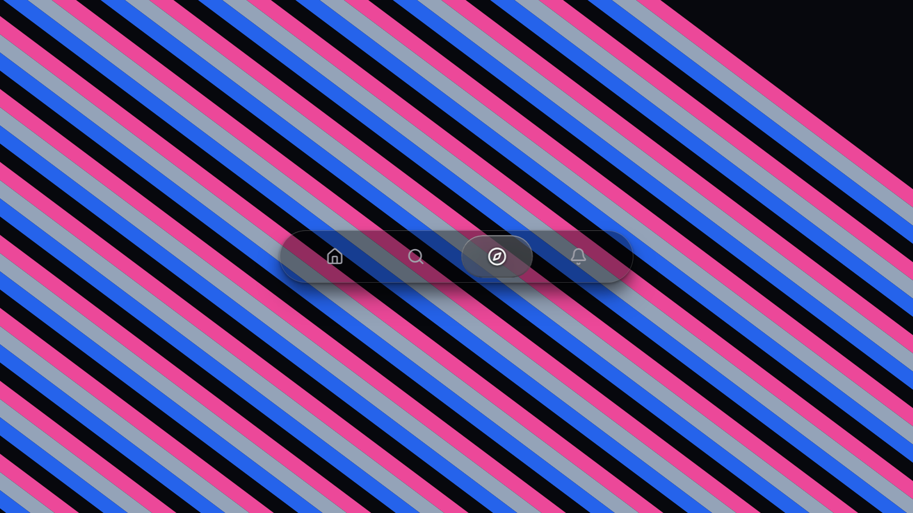
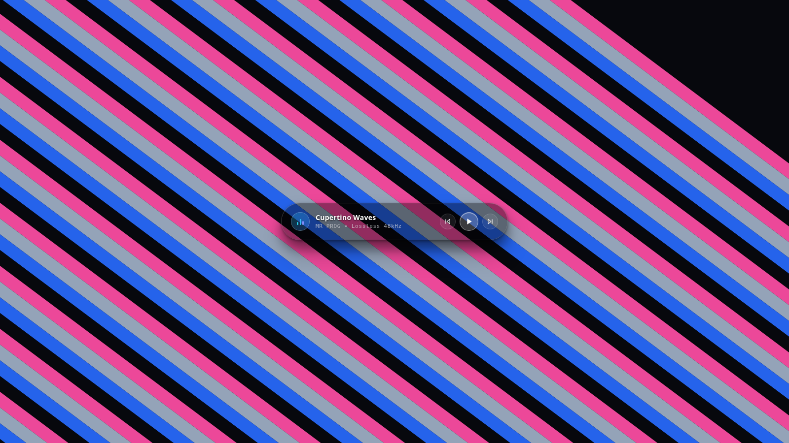

<div align="center">

# Liquid Glass Effect

### Real-Time Optical Physics Engine for React

Physical Snell's law refraction, parametric meniscus beveling, and chromatic dispersion.  
Engineered for luxury user interfaces with zero core distortion and 120 FPS hardware acceleration.

<br />

[](https://www.npmjs.com/package/@mr-prog/liquid-glass)
[](https://opensource.org/licenses/MIT)
[](https://mr-pr0g.github.io/LiquidGlass/)
[](https://mr-pr0g.github.io/LiquidGlass/)
[](https://mr-pr0g.github.io/LiquidGlass/)

<br />

**[Live Interactive Studio](https://mr-pr0g.github.io/LiquidGlass/)** &bull; **[NPM Registry](https://www.npmjs.com/package/@mr-prog/liquid-glass)** &bull; **[Documentation](#installation)**

<br />

<p align="center">
  
</p>

</div>

---

## The Optical Paradigm: Why Liquid Glass?

Nearly every existing web "glassmorphism" implementation relies on CSS `backdrop-filter: blur()`. That technique produces flat, cloudy frosted plastic. Physical glass does not merely blur background light; **glass refracts it**.

Liquid Glass is an optical simulation engine written in WebGL 2.0 / GLSL 300es that replaces synthetic filters with physical ray-tracing.

### 1. Vector Snell's Law Ray-Tracing
Light deflection is computed per-fragment in real time according to Snell's law:

$$n_1 \sin(\theta_1) = n_2 \sin(\theta_2)$$

Background textures, geometry, and imagery undergo continuous spatial displacement relative to the glass thickness, surface curvature, and observer angle.

### 2. Parametric Meniscus Edge with Undistorted Flat Core
Uniform lens shaders distort the entire surface, rendering typography and user interface elements unreadable. Liquid Glass solves this through a dual-domain SDF formulation:
- **Curved Meniscus Perimeter**: Optical bending and chromatic splitting are focused strictly along the outer perimeter bevel.
- **Crystal-Clear Core Face**: Light entering normal to a flat interface undergoes zero lateral displacement ($0^\circ$ incident angle). The central interactive face remains 100% crisp and undistorted.

### 3. Multi-Wavelength Chromatic Dispersion ($\Delta\lambda$)
Simulates physical crown glass dispersion ($n_d = 1.52$) by splitting incident light into discrete spectral wavelengths:

$$\vec{r}_{\text{red}} = \vec{r} \cdot (1.0 - \text{dispersion} \times 0.35)$$
$$\vec{r}_{\text{blue}} = \vec{r} \cdot (1.0 + \text{dispersion} \times 0.35)$$

High-contrast background lines and shapes separate into red, green, and blue spectral caustics along curved bevel borders.

### 4. Dynamic 3D Meniscus Deformation for Interactive Elements
Icons and typography passing underneath the liquid lens do not remain static. As elements traverse the lens meniscus, the engine dynamically applies continuous 3D astigmatic transformation:
- **Radial Meniscus Stretch**: Proportional expansion along the curved outer lip.
- **Volumetric Micro-Compression**: Preserves visual element density along the perpendicular axis.
- **Spherical Dome Curvature**: 3D perspective rotation (`perspective`, `rotateX`, `rotateY`, `skewX`) simulating transmission through a convex liquid droplet.

### 5. 120 FPS Mobile Hardware Pipeline
Built with hardware-accelerated fragment shaders, singleton texture caching, and automatic render-loop suspension when idle. The engine executes at native 120 FPS on Apple Silicon and modern mobile devices with sub-1ms draw calls.

---

## Installation

```bash
npm install @mr-prog/liquid-glass
# or
pnpm add @mr-prog/liquid-glass
# or
yarn add @mr-prog/liquid-glass
```

---

## Quick Start

Import the component and stylesheet into any React application:

```tsx
import { LiquidGlass } from '@mr-prog/liquid-glass';
import '@mr-prog/liquid-glass/liquid-glass.css';

export default function App() {
  return (
    <div className="min-h-screen bg-[#07070b] flex items-center justify-center p-6">
      <LiquidGlass mode="nav" />
    </div>
  );
}
```

---

## Component Modes

### 1. Flagship Navigation Bar (`mode="nav"`)

Draggable squircle liquid lens with fluid momentum, elastic boundary resistance, responsive slot tracking, and strict optical boundary clipping:

```tsx
<LiquidGlass 
  mode="nav" 
  activeIndex={0} 
  onChange={(index) => console.log('Active tab:', index)} 
/>
```

<br />

### 2. Cupertino Luxury Audio Player (`mode="player"`)

Minimalist frosted glass disc with dynamic 3-bar animated equalizer, lossless 48kHz audio badge, and responsive circular frosted glass controls:

```tsx
<LiquidGlass 
  mode="player" 
  audioTitle="Cupertino Waves" 
  audioArtist="MR PROG • Lossless 48kHz"
/>
```

<p align="center">
  
</p>

<br />

### 3. Viscous Fluid Typography (`mode="text"`)

Ray-traced text refracting underlying backdrops with physical surface curvature:

```tsx
<LiquidGlass 
  mode="text" 
  text="LIQUID GLASS" 
/>
```

<br />

### 4. Custom Container (`mode="empty"`)

Wrap custom React components inside a physical liquid glass container:

```tsx
<LiquidGlass mode="empty" radius={24} className="p-8">
  <h2 className="text-white text-xl font-bold">Custom Glass Surface</h2>
  <p className="text-zinc-400 text-sm mt-1">Physical ray-tracing with custom children inside.</p>
</LiquidGlass>
```

---

## Configuration Reference

All properties map directly to physical optical variables:

| Prop | Type | Default | Description |
| :--- | :--- | :--- | :--- |
| `mode` | `'nav' \| 'player' \| 'text' \| 'empty'` | `'nav'` | Pre-configured interactive component mode. |
| `refraction` | `number` | `0.344` | Snell ray-tracing optical power along curved meniscus edges. |
| `bevel` | `number` | `28` | Width of the curved meniscus rim in screen pixels. |
| `dispersion` | `number` | `0.28` | Spectral prism RGB wavelength divergence ($\Delta\lambda$). |
| `darkTint` | `number` | `0.15` | Translucent optical absorption coefficient. |
| `blur` | `number` | `0` | Internal frosted micro-surface diffusion. |
| `radius` | `number` | `9999` | Corner rounding (`9999` for capsule/pill, `16–36` for cards). |
| `wallpaper` | `'cross' \| 'stripes' \| 'none'` | `'cross'` | Hardware-accelerated test backdrop. |

---

## Custom Navigation Items

Provide custom icons, labels, and notification badges with standard Lucide React icons:

```tsx
import { useState } from 'react';
import { LiquidGlass } from '@mr-prog/liquid-glass';
import { Home, Compass, Bell, User } from 'lucide-react';
import '@mr-prog/liquid-glass/liquid-glass.css';

export function Navigation() {
  const [active, setActive] = useState(0);

  return (
    <LiquidGlass
      mode="nav"
      activeIndex={active}
      onChange={setActive}
      items={[
        { id: 'home', label: 'Home', icon: Home },
        { id: 'explore', label: 'Explore', icon: Compass },
        { id: 'alerts', label: 'Alerts', icon: Bell, badge: true },
        { id: 'profile', label: 'Profile', icon: User },
      ]}
    />
  );
}
```

---

## Author & License

Engineered by **[MR PROG](https://github.com/MR-PR0G)**.  
Released under the [MIT License](LICENSE). Open-source, free for personal and commercial applications.
