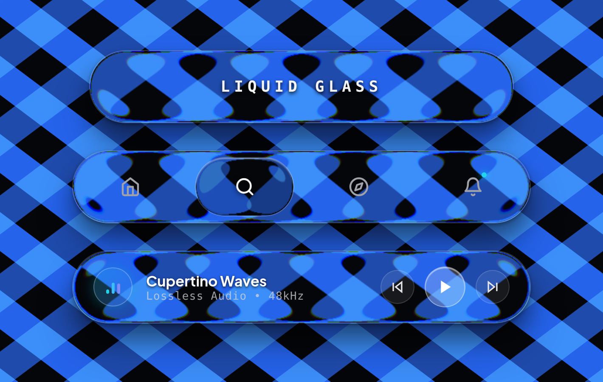

<div align="center">

# 💧 Liquid Glass

### The physical liquid glass effect for React & the modern web.

No more cloudy, flat `backdrop-filter: blur()` plastic.  
**Real optical refraction, smooth curved meniscus borders, and subtle chromatic dispersion — running at a silky-smooth 120 FPS.**

<br />

[](https://mr-pr0g.github.io/LiquidGlass/)
[](https://www.npmjs.com/package/@mr-prog/liquid-glass)
[](https://mr-pr0g.github.io/LiquidGlass/)
[](https://mr-pr0g.github.io/LiquidGlass/)
[](https://opensource.org/licenses/MIT)

<br />

<p align="center">
  <a href="https://mr-pr0g.github.io/LiquidGlass/">
    
  </a>
</p>

<br />

<p align="center">
  <a href="https://mr-pr0g.github.io/LiquidGlass/">
    
  </a>
  &nbsp;&nbsp;
  <a href="https://www.npmjs.com/package/@mr-prog/liquid-glass">
    
  </a>
</p>

<p align="center">
  <a href="https://mr-pr0g.github.io/LiquidGlass/"><strong>👉 Click to open the Interactive Live Demo 👈</strong></a>
</p>

</div>

---

## ✨ Why Liquid Glass?

Most "glassmorphism" tutorials tell you to slap `backdrop-filter: blur(10px)` on a semi-transparent div. But that doesn't look like real glass — it looks like foggy plastic.

In the real world, glass **bends light**:

* 🌊 **True Optical Refraction**: Background elements stretch, curve, and magnify along the edges based on Snell's law.
* ⚡ **Instant Sub-Millisecond Rendering (< 0.8ms)**: Ray tracing runs in a single-pass WebGL2 shader with zero CPU overhead, rendering instantly at 120 FPS. The engine suspends automatically when idle to preserve mobile battery life.
* 💎 **Crystal-Clear Center**: The curved meniscus is focused strictly on the outer bevel — leaving your typography, icons, and buttons 100% crisp, sharp, and readable.
* 🌈 **Prism Chromatic Dispersion**: Subtle split of red and blue wavelengths along curved edges for a luxury physical look.

---

## 📦 Installation

Grab the package using your favorite package manager:

```bash
npm install @mr-prog/liquid-glass
# or
pnpm add @mr-prog/liquid-glass
# or
yarn add @mr-prog/liquid-glass
```

---

## 🚀 Quick Start

Import the component and stylesheet, and you're good to go:

```tsx
import { LiquidGlass } from '@mr-prog/liquid-glass';
import '@mr-prog/liquid-glass/liquid-glass.css';

export default function App() {
  return (
    <div className="min-h-screen bg-[#07070b] flex items-center justify-center p-6">
      {/* Flagship Draggable Navigation Bar */}
      <LiquidGlass mode="nav" />
    </div>
  );
}
```

---

## 🎨 Built-in Modes

Liquid Glass comes out-of-the-box with 3 ready-to-use presets, or you can wrap custom content:

### 1. 🧭 Navigation Bar (`mode="nav"`)
A fluid navigation capsule featuring a draggable liquid lens that tracks your finger or mouse with elastic momentum, snapping to tabs with organic jelly physics:

```tsx
<LiquidGlass 
  mode="nav" 
  activeIndex={0} 
  onChange={(index) => console.log('Active tab:', index)} 
/>
```

### 2. 🎵 Luxury Cupertino Player (`mode="player"`)
A minimalist frosted glass music player with dynamic animated 3-bar equalizer, glowing disc, and responsive controls:

```tsx
<LiquidGlass 
  mode="player" 
  audioTitle="Cupertino Waves" 
  audioArtist="MR PROG • Lossless 48kHz"
  isPlaying={true}
/>
```

### 3. ✨ Refracted Typography & Custom Containers
Display ray-traced viscous typography or wrap your own custom React components:

```tsx
{/* Refracted Typography */}
<LiquidGlass mode="text" text="LIQUID GLASS" />

{/* Custom Container */}
<LiquidGlass mode="empty" radius={24} className="p-8">
  <h2 className="text-white text-xl font-bold">Custom Glass Card</h2>
  <p className="text-zinc-400 text-sm mt-1">Wrap any React component in authentic liquid glass.</p>
</LiquidGlass>
```

---

## ⚙️ Complete Props & Variables Reference

Every prop is designed with physical intuition. Sensible defaults provide pristine optics out-of-the-box, while full granular control allows you to customize every aspect of refraction, colors, geometry, 3D shadows, and fluid elasticity.

---

### 1. 🧪 Optical Ray-Tracing & Snell Physics

Controls the single-pass WebGL2 hardware ray-tracing engine and physical light bending equations.

| Prop | Type | Default | Range / Values | Description |
| :--- | :--- | :--- | :--- | :--- |
| `refraction` | `number` | `0.344` | `0.00 – 1.00` | Snell's law physical refraction index. Dictates the angle and power of light bending through the curved glass meniscus edges. |
| `bevel` | `number` | `28` | `4 – 64 px` | Meniscus curvature bevel width in pixels. Defines where light bends while preserving an undistorted, crystal-clear center. |
| `dispersion` | `number` | `0.28` | `0.00 – 1.00` | Prismatic chromatic dispersion. Splits red and blue spectral wavelengths along curved borders for an authentic physical look. |
| `blur` | `number` | `0` | `0 – 20 px` | Concentric Gaussian frosted diffusion in pixels. `0` keeps the glass 100% transparent and clear; higher values add luxury frosted glass diffusion. |
| `thickness` | `number` | `450` | `150 – 750 nm` | Volumetric glass dome thickness in nanometers. Modulates refraction chord depth and specular rim bounce. |
| `thicknessStep` | `number` | `5` | `0 – 10` | Discrete step multiplier for thickness (`0` = ultra-thin, `5` = balanced, `9–10` = hyper-refractive convex lens). |
| `reflectivity` | `number` | `0.65` | `0.00 – 1.00` | Top surface Fresnel glaze reflection intensity across the front squircle face. |
| `glintIntensity` | `number` | `0.75` | `0.00 – 1.00` | Meniscus specular sweep and light glint brightness along the rim. |

---

### 2. 🎨 Color, Tints & Translucency

Manages glass absorption layers and color tones in calibrated linear sRGB space.

| Prop | Type | Default | Range / Values | Description |
| :--- | :--- | :--- | :--- | :--- |
| `darkTint` | `number` | `0.15` | `0.00 – 0.75` | Translucent dark absorption layer. `0.00` is water-white crystal glass, `0.15` is smoked luxury glass, `0.45+` is obsidian dark glass. |
| `darkTintStep` | `number` | `5` | `0 – 10` | Discrete darkness level corresponding to generator sliders. |
| `tintColor` | `string` | `"#000000"` | Hex color string | Custom base glass tint color (e.g. `#000000` neutral obsidian, `#0c192c` sapphire dark, `#1e0826` amethyst violet). |

---

### 3. 📐 Geometry, Squircles & Chromatic Borders

Manages squircle curvature (continuous G2 curvature) and border specular highlights.

| Prop | Type | Default | Range / Values | Description |
| :--- | :--- | :--- | :--- | :--- |
| `radius` | `number` | `9999` | `0 – 9999 px` | Global corner radius in pixels. `9999` creates a pill/capsule shape; `16–36` creates modern squircle cards. |
| `topRadius` | `number` | `undefined` | `0 – 9999 px` | Independent top corner radius in pixels for asymmetric card geometry. |
| `bottomRadius` | `number` | `undefined` | `0 – 9999 px` | Independent bottom corner radius in pixels. |
| `borderOpacity` | `number` | `0.18` | `0.00 – 1.00` | Specular glass border stroke opacity. `0.00` gives a rimless finish; `0.20–0.40` gives a sharp diamond rim. |
| `borderGradient` | `string` | `undefined` | CSS gradient | Custom CSS gradient for chromatic rim lighting (e.g. Prism Rainbow, Electric Cyan, Sunset Gold, Liquid Chrome). |

---

### 4. 💡 3D Elevation & Inverted Caustic Aura

Controls multi-layer external shadows and internal caustic refraction halos.

| Prop | Type | Default | Range / Values | Description |
| :--- | :--- | :--- | :--- | :--- |
| `shadowStep` | `number` | `5` | `0 – 10` | External 3D drop shadow elevation scale. `0` is flat on backdrop; `10` produces high-altitude luxury elevation. |
| `shadowTone` | `'3d' \| 'dark' \| 'light'` | `'3d'` | `'3d'`, `'dark'`, `'light'` | Ambient lighting personality. `'3d'` uses multi-bounce ambient occlusion; `'dark'` uses deep luxury shadows; `'light'` casts a soft neon rim glow. |
| `isShadowInverted` | `boolean` | `false` | `true \| false` | Inverts external drop shadow into an internal 360° caustic refraction aura falling into the glass container. |

---

### 5. 🌊 Fluid Dynamics & Drag Viscosity

Controls viscoelastic tension resistance, spring recovery dynamics, and surface interactions.

| Prop | Type | Default | Range / Values | Description |
| :--- | :--- | :--- | :--- | :--- |
| `viscosity` | `number` | `0.60` | `0.10 – 1.00` | Fluid drag tension resistance. Low values create liquid jelly wobble; high values create stiff viscoelastic glass give. |
| `viscosityStep` | `number` | `5` | `0 – 10` | Discrete viscosity step corresponding to generator sliders. |
| `tensionX` | `number` | `0` | `-120 to +120 px` | Direct horizontal fluid elastic stretch offset in pixels. |
| `onTension` | `(x: number) => void` | `undefined` | Function callback | Fires during horizontal pointer drag with instantaneous elastic tension displacement. |
| `interactive` | `boolean` | `true` | `true \| false` | Enables surface wave deformation and organic press reactions on mouse hover and touch clicks. |
| `wobble` | `number` | `0.00` | `0.00 – 1.00` | Dynamic fluid jelly wobble elasticity. |

---

### 6. 🎛️ Modes & Preset Handlers

Configuration for built-in flagship presets and custom content wrapping.

| Prop | Type | Default | Applies To | Description |
| :--- | :--- | :--- | :--- | :--- |
| `mode` | `string` | `'nav'` | All | Active presentation mode: `'nav'` (navbar), `'text'` (draggable typography), `'player'` (audio player), `'empty'` (custom children). |
| `items` | `NavbarItem[]` | Default 4 tabs | `mode="nav"` | Array of tab objects: `{ id, label, icon: LucideIcon, badge?: boolean }`. |
| `activeIndex` | `number` | `1` | `mode="nav"` | Controlled active tab index. The liquid meniscus lens smoothly glides and snaps to this index. |
| `defaultIndex` | `number` | `1` | `mode="nav"` | Initial active tab when uncontrolled. |
| `onChange` | `(index, item) => void` | `undefined` | `mode="nav"` | Callback invoked whenever user clicks or drags the liquid lens to a new tab. |
| `accentColor` | `string` | `"#22d3ee"` | `mode="nav"` | Color for notification badge and active glow accents. |
| `text` | `string` | `"LIQUID GLASS"` | `mode="text"` | Custom editorial typography string rendered inside the draggable elastic capsule. |
| `audioTitle` | `string` | `"Cupertino Waves"` | `mode="player"` | Primary track title string for audio player mode. |
| `audioArtist` | `string` | `"MR PROG • Lossless 48kHz"` | `mode="player"` | Secondary track artist and quality metadata string. |
| `isPlaying` | `boolean` | `true` | `mode="player"` | Playback state controlling play/pause icons and pulsating equalizer bars. |
| `onPlayToggle` | `() => void` | `undefined` | `mode="player"` | Toggle playback callback for play/pause button. |
| `onNextTrack` | `() => void` | `undefined` | `mode="player"` | Skip to next track callback. |
| `onPrevTrack` | `() => void` | `undefined` | `mode="player"` | Skip to previous track callback. |
| `backdrop` | `RefObject` | `null` | All | Optional React Ref to an underlying canvas or element for real-time hardware Snell ray-tracing. |
| `wallpaper` | `string` | `'cross'` | All | Built-in optical test pattern (`'cross'` = Bold Blue Cross from flagship demo, `'stripes'`, `'none'` = transparent). |
| `children` | `ReactNode` | `undefined` | `mode="empty"` | Arbitrary React children wrapped inside the optical liquid glass container. |

---

## 💡 Production Recipes

### 1. Asymmetric Squircle Glass Card with Chromatic Border

```tsx
import { LiquidGlass } from '@mr-prog/liquid-glass';
import '@mr-prog/liquid-glass/liquid-glass.css';

export function GlassCard() {
  return (
    <LiquidGlass
      mode="empty"
      topRadius={36}
      bottomRadius={16}
      borderOpacity={0.25}
      borderGradient="linear-gradient(135deg, #38bdf8, #818cf8, #c084fc, #f472b6, #fb923c)"
      shadowTone="3d"
      shadowStep={7}
      refraction={0.42}
      bevel={32}
      dispersion={0.35}
      className="p-8 max-w-md w-full"
    >
      <div className="space-y-3">
        <span className="text-cyan-400 font-mono text-xs tracking-wider uppercase">Physical Ray-Tracing</span>
        <h3 className="text-white text-2xl font-bold">Liquid Prism Card</h3>
        <p className="text-zinc-300 text-sm leading-relaxed">
          Asymmetric continuous squircle curvature with multi-spectral chromatic dispersion along the borders.
        </p>
      </div>
    </LiquidGlass>
  );
}
```

### 2. Inverted 360° Caustic Aura (Dark Obsidian Glass)

```tsx
import { LiquidGlass } from '@mr-prog/liquid-glass';
import '@mr-prog/liquid-glass/liquid-glass.css';

export function CausticContainer() {
  return (
    <LiquidGlass
      mode="empty"
      radius={28}
      darkTint={0.28}
      tintColor="#0c192c"
      isShadowInverted={true}
      shadowTone="3d"
      shadowStep={8}
      refraction={0.50}
      bevel={38}
      className="p-6"
    >
      <p className="text-cyan-200 font-mono text-sm">
        External shadow is inverted into an internal 360° refractive caustic halo.
      </p>
    </LiquidGlass>
  );
}
```

### 3. Fully Controlled Navigation Bar with Custom Tabs

```tsx
import { useState } from 'react';
import { LiquidGlass } from '@mr-prog/liquid-glass';
import { Home, Compass, Bell, User } from 'lucide-react';
import '@mr-prog/liquid-glass/liquid-glass.css';

export function Navigation() {
  const [activeTab, setActiveTab] = useState(1);

  return (
    <LiquidGlass
      mode="nav"
      activeIndex={activeTab}
      onChange={(idx, item) => {
        console.log('Switched to tab:', idx, item.label);
        setActiveTab(idx);
      }}
      accentColor="#38bdf8"
      refraction={0.38}
      bevel={28}
      dispersion={0.28}
      items={[
        { id: 'home', label: 'Home', icon: Home },
        { id: 'search', label: 'Search', icon: Compass },
        { id: 'alerts', label: 'Alerts', icon: Bell, badge: true },
        { id: 'profile', label: 'Profile', icon: User },
      ]}
    />
  );
}
```

### 4. Interactive Cupertino Audio Player

```tsx
import { useState } from 'react';
import { LiquidGlass } from '@mr-prog/liquid-glass';
import '@mr-prog/liquid-glass/liquid-glass.css';

export function AudioPlayer() {
  const [isPlaying, setIsPlaying] = useState(true);

  return (
    <LiquidGlass
      mode="player"
      audioTitle="Cupertino Waves"
      audioArtist="MR PROG • Lossless 48kHz"
      isPlaying={isPlaying}
      onPlayToggle={() => setIsPlaying(!isPlaying)}
      onNextTrack={() => console.log('Next track')}
      onPrevTrack={() => console.log('Previous track')}
      shadowTone="3d"
      shadowStep={6}
    />
  );
}
```

---

## 📄 License

Created by **[MR PROG](https://github.com/MR-PR0G)**.  
Distributed under the **MIT License**. Free for personal and commercial projects.
