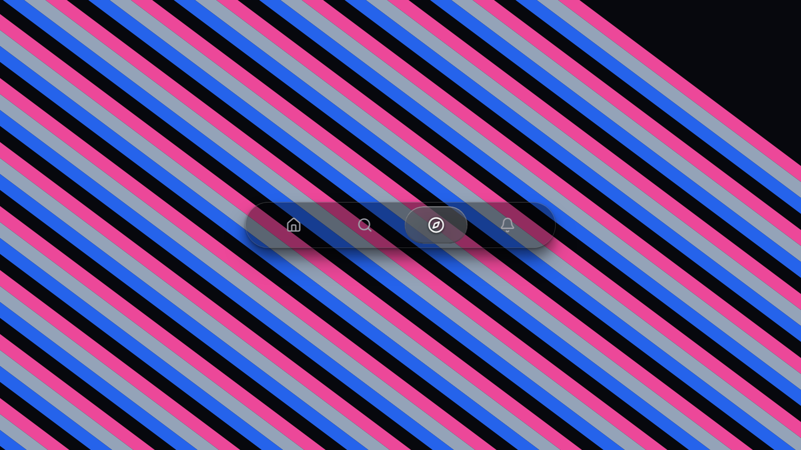
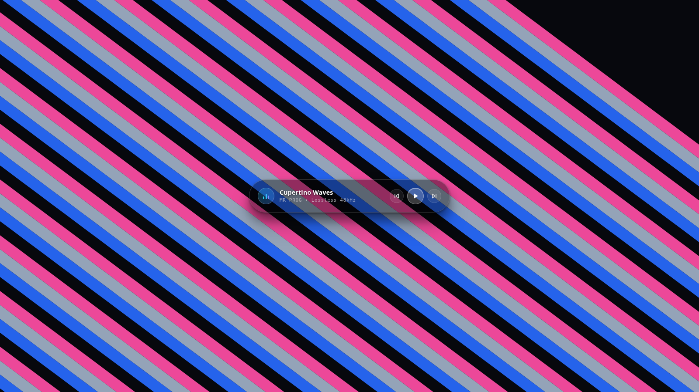

<div align="center">

# @mr-prog/liquid-glass

### Real-Time Optical Physics Engine for React

Physical Snell's law refraction, parametric meniscus beveling, and chromatic dispersion.  
Engineered for luxury user interfaces with zero core distortion and 120 FPS hardware acceleration.

<br />

[](https://www.npmjs.com/package/@mr-prog/liquid-glass)
[](https://opensource.org/licenses/MIT)
[](https://mr-pr0g.github.io/LiquidGlass/)
[](https://mr-pr0g.github.io/LiquidGlass/)
[](https://mr-pr0g.github.io/LiquidGlass/)

<br />

**[Live Interactive Studio](https://mr-pr0g.github.io/LiquidGlass/)** &bull; **[NPM Registry](https://www.npmjs.com/package/@mr-prog/liquid-glass)** &bull; **[GitHub Repository](https://github.com/MR-PR0G/LiquidGlass)**

<br />

<p align="center">
  
</p>

</div>

---

## The Optical Paradigm: Why Liquid Glass?

Nearly every existing web "glassmorphism" library merely applies CSS `backdrop-filter: blur()`. That produces flat, cloudy plastic. Physical glass does not merely blur light; **glass bends and refracts light**.

Liquid Glass is an optical simulation engine written in WebGL 2.0 / GLSL 300es that replaces synthetic filters with physical ray-tracing.

- **Vector Snell's Law Ray-Tracing**: Deflects underlying background pixels according to Snell's law ($n_1 \sin\theta_1 = n_2 \sin\theta_2$).
- **Parametric Meniscus Bevel**: Refraction is focused strictly along curved perimeter edges while the central face remains 100% crisp and readable.
- **Spectral Chromatic Dispersion ($\Delta\lambda$)**: Splits incident light into red, green, and blue wavelengths ($n_d = 1.52$) along curved bevel borders.
- **Dynamic 3D Meniscus Deformation**: Elements traversing under the lens dynamically stretch and bulge in 3D perspective (`perspective`, `rotateX`, `rotateY`, `skewX`).
- **120 FPS Zero-Overhead GPU Pipeline**: Hardware-accelerated shaders with singleton texture caching and automatic idle-loop suspension.

---

## Installation

```bash
npm install @mr-prog/liquid-glass
# or
pnpm add @mr-prog/liquid-glass
# or
yarn add @mr-prog/liquid-glass
```

---

## Quick Start

```tsx
import { LiquidGlass } from '@mr-prog/liquid-glass';
import '@mr-prog/liquid-glass/liquid-glass.css';

export default function App() {
  return (
    <div className="min-h-screen bg-[#07070b] flex items-center justify-center p-6">
      <LiquidGlass mode="nav" />
    </div>
  );
}
```

---

## Component Modes

The `<LiquidGlass />` component supports four production modes:

- `mode="nav"`: Draggable squircle liquid lens navigation bar.
- `mode="player"`: Cupertino luxury audio player with animated EQ disc and frosted glass controls.
- `mode="text"`: Viscous ray-traced typography refracting background elements.
- `mode="empty"`: Pure physical liquid glass card container for custom children.

```tsx
{/* 1. Flagship Navigation Bar */}
<LiquidGlass mode="nav" />

{/* 2. Luxury Cupertino Audio Player */}
<LiquidGlass mode="player" audioTitle="Cupertino Waves" />

{/* 3. Fluid Ray-Traced Typography */}
<LiquidGlass mode="text" text="LIQUID GLASS" />

{/* 4. Custom Glass Card Container */}
<LiquidGlass mode="empty" radius={24} className="p-8">
  <h2 className="text-white text-xl font-bold">Custom Surface</h2>
</LiquidGlass>
```

<p align="center">
  
</p>

---

## Configuration Reference

| Prop | Type | Default | Description |
| :--- | :--- | :--- | :--- |
| `mode` | `'nav' \| 'player' \| 'text' \| 'empty'` | `'nav'` | Pre-configured interactive mode. |
| `refraction` | `number` | `0.344` | Snell ray-tracing refraction strength. |
| `bevel` | `number` | `28` | Curved meniscus rim width in pixels. |
| `dispersion` | `number` | `0.28` | Spectral prism RGB wavelength divergence. |
| `darkTint` | `number` | `0.15` | Translucent optical absorption coefficient. |
| `blur` | `number` | `0` | Internal frosted micro-surface diffusion. |
| `radius` | `number` | `9999` | Corner rounding (`9999` for capsule, `16–36` for cards). |
| `wallpaper` | `'cross' \| 'stripes' \| 'none'` | `'cross'` | Hardware-accelerated test backdrop. |

---

## Author & License

Engineered by **[MR PROG](https://github.com/MR-PR0G)**.  
Released under the [MIT License](LICENSE).
